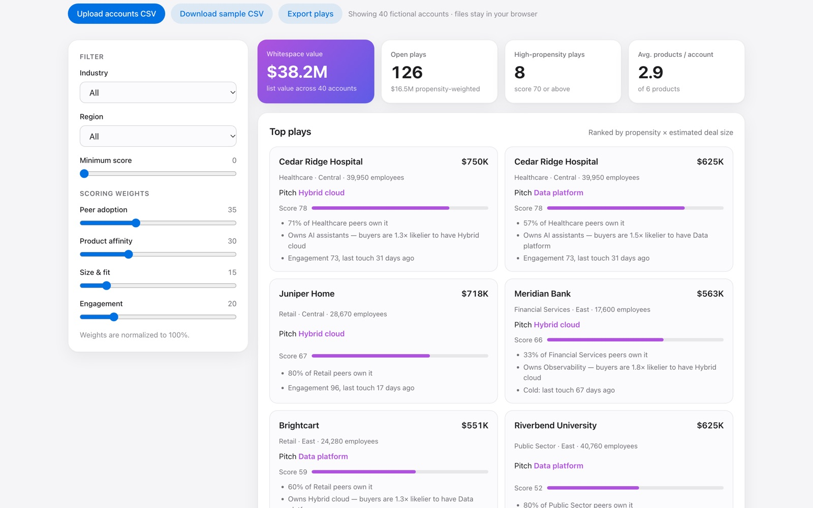

# Whitespace

Find and rank cross-sell opportunities across an account base, with a plain-English reason behind every play.

**[Live demo →](https://darshanpatil.me/work/whitespace/)**



## The problem

Every enterprise seller has accounts that own some products and not others. Working out which gap to pitch to which account usually means hours of manual account research, so reps fall back on gut feel or whichever account is loudest.

## What it does

- Scores every **account × product** combination the customer doesn't own yet.
- Ranks the **top plays** by propensity × estimated deal size, with the reasons spelled out ("71% of Healthcare peers own it", "buyers of Data platform are 1.8× likelier to have AI assistants").
- Shows a **whitespace heatmap** of the account base and a **product affinity (lift) matrix**.
- Lets you re-weight the scoring model, filter by industry and region, and export the play list as CSV.
- Accepts your own account list as CSV.

## Scoring model

| Signal | Definition |
|---|---|
| Peer adoption | Share of other accounts in the same industry that own the product |
| Product affinity | Strongest lift among products already owned: P(product \| owns X) ÷ P(product) |
| Size & fit | Log-scaled employee count, normalized across the base |
| Engagement | Engagement score × exp(−days since last touch ÷ 90) |

The weighted score is rescaled to 0–100 across all open plays. Estimated deal size = illustrative list price × √(employees ÷ 5,000), clamped.

**CSV format:** `account, industry, region, employees, engagement, last_touch_days` plus a 0/1 column per product: `data_platform, ai_assistants, automation, security, hybrid_cloud, observability`.

All accounts in the sample are fictional.

## Run it locally

No build step and no dependencies. Serve the folder with any static server:

```bash
python3 -m http.server 8000
# open http://localhost:8000
```

## Project structure

```
index.html   page layout and copy
app.js       data generation, model, and rendering
app.css      page-specific styles
kit.js       shared helpers: seeded RNG, CSV import/export, SVG charts, tooltips
kit.css      shared UI kit (light + dark mode)
```

Charts are hand-built SVG with no charting library. Everything runs client-side, so uploaded files never leave the browser.

## Data

The bundled sample data is **synthetic**, generated from a seeded random process so it is reproducible. It does not describe any real company or customer.

---

Built by [Darshan Patil](https://darshanpatil.me) · [LinkedIn](https://www.linkedin.com/in/darshan-patil-/)
